# Práctica: un catálogo reproducible con MCP

## Ejercicio 1 · Punto de entrada

### Ejecuta `uv run python -c "import main"`. 

Resultado:

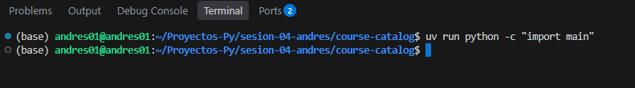

### Explica por qué no consulta el catálogo.
    Aunque el archivo main.py contine toda la logica para consultar el catálogo, este se esta importando desde consola "import main", y con esto el interprete solo lee las funciones y clases pero no ejecuta el bloque main.

### Identifica también la condición que impide iniciar el transporte al importar `server.py`.
    De forma similar que el "import main", cuando se importa server.py desde otro archivo, no se inicializa el servidor porque está dentro de la condición "if __name__ == "__main__" impidiendo que se ejecute "mcp.run(transport="stdio")".

### Distingue registrar una herramienta de iniciar el servidor.
    Cuando se inicia un servidor se hace referencia a iniciar el bucle de escucha de peticiones en stdin y responde por stdout. Mientras que registrar una herramienta, se realiza a través de la definición de una función encapsulada en el decorador @mcp.tool() y con la descripción de lo que realiza la función.

## Ejercicio 2 · Datos y argumentos

### Copia `data/courses.json` a `data/extra_courses.json` y agrega un curso cuyo título incluya Python.
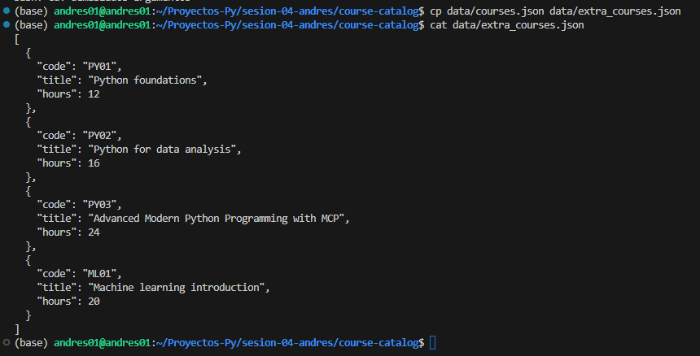

### Usa `--catalog` para consultar esa copia desde `main.py` y comprueba que aparecen tres resultados. 
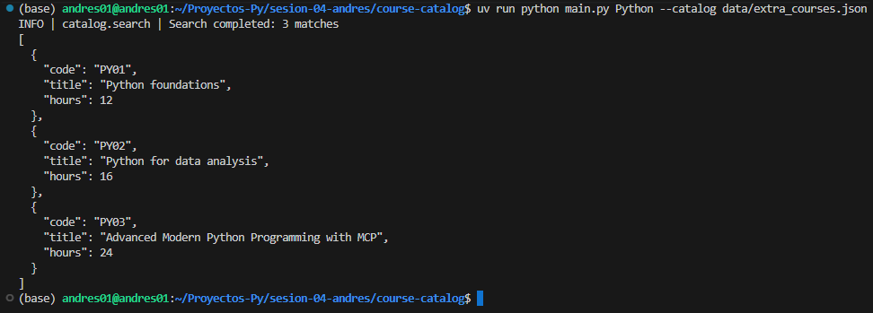

### Prueba una ruta inexistente y registra el código de salida. 
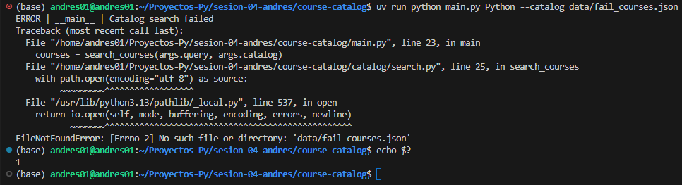

### La herramienta MCP sigue usando el catálogo predeterminado.
    El script server.py importa e invoca directamente la función search_courses(query) sin pasarle ningún parámetro para la ruta del catálogo. Al no suministrar el argumento path, la función utiliza el valor por defecto definido en en el atributo DEFAULT_CATALOG, que apunta al catálogo predeterminado.

## Ejercicio 3 · Niveles y destinos

### Compara una misma consulta con DEBUG, INFO y ERROR. 
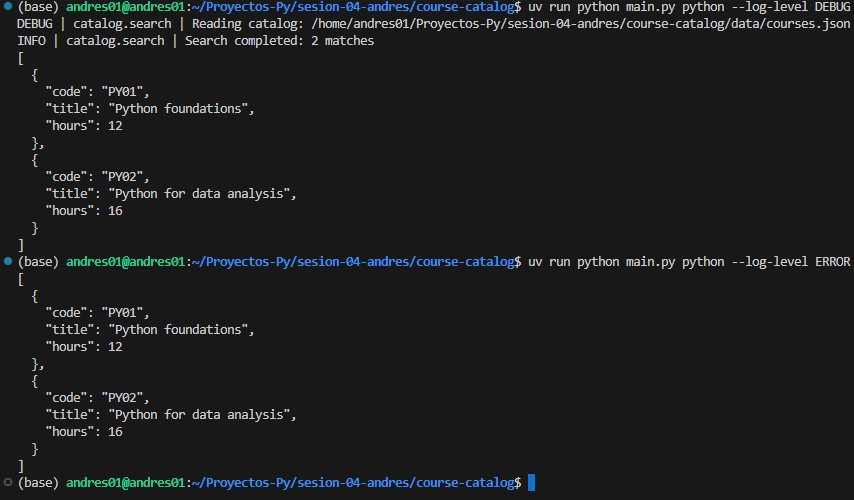

### Después usa `--log-level ERROR --log-file logs/app.log`.

### Explica por qué el archivo conserva mensajes que no aparecen en consola y por qué stdout debe reservarse al protocolo en `server.py`.
    La configuración de logger (definido en catalog/logging_config.py) está diseñado de forma que el argumento --log-level ERROR configura el nivel de filtrado para el manejador de consola (StreamHandler), impidiendo que se impriman mensajes inferiores a ERROR en pantalla. Sin embargo, al especificar un archivo mediante --log-file, el manejador de archivos (FileHandler) se configura por defecto para registrar todos los niveles de log detallados (como DEBUG e INFO).
    En cuanto a reservar stdout, si el servidor (server.py) llegara a imprimir logs, advertencias o cualquier texto plano informativo en stdout, corrompería el flujo de datos (JSON-RPC) utilizado en el protocolo MCP.
    
## Ejercicio 4 · Mejorar el diagnóstico

### Añade al mensaje INFO de `catalog/search.py` la cantidad total de cursos leídos, además de la cantidad de coincidencias. Usa argumentos de logging.
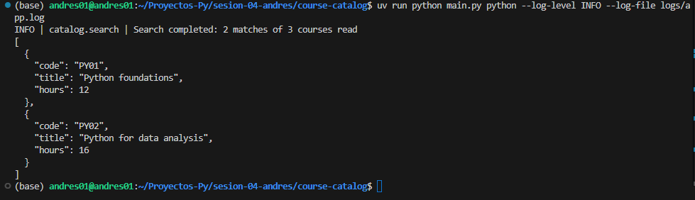

### Comprueba que la consulta directa y la llamada MCP siguen devolviendo los mismos cursos.
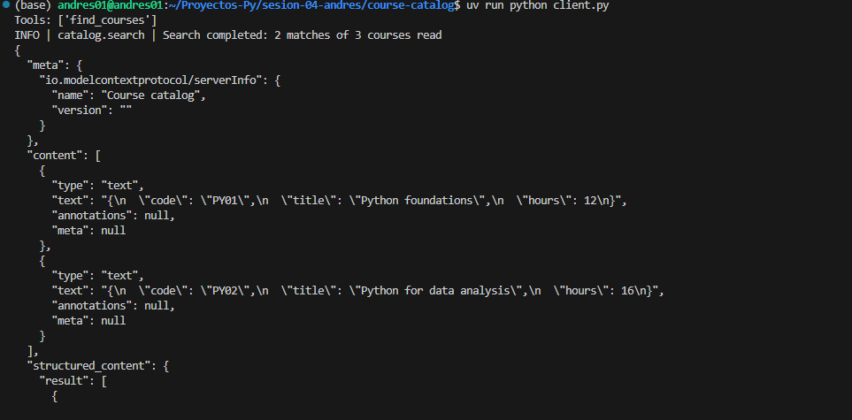

## Ejercicio 5 · Reproducción y llamada MCP

### Desde una copia limpia, ejecuta `uv sync --locked` y `client.py` con `python`, `astronomy` y una cadena de espacios. 
**Con "python"**

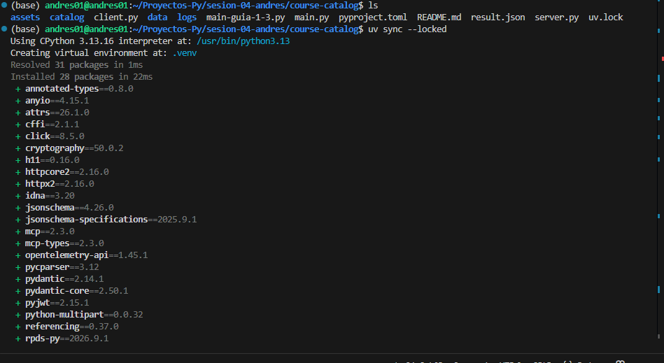

**Con "astronomy"**

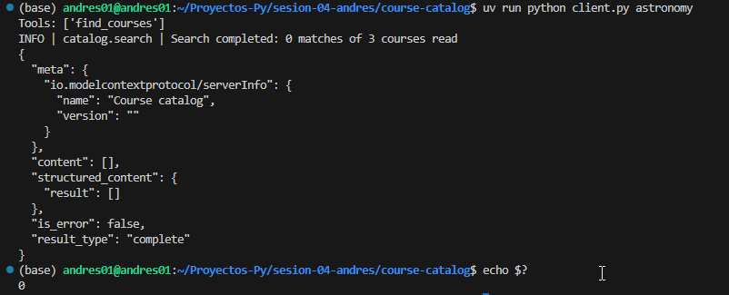

**Con "   "**

### Identifica la herramienta disponible y distingue respuesta vacía de error. 
    Cuando se arranca el server desde el cliente este muestra el mensaje: "Tools: ['find_courses']"

    Para distinguir la respuesta vacía de error, vemos que en el caso de "astronomy" cuando se imprimipe el result tiene un a "content" vacio "[]" y en el atributo "is_error" el valor false, indicando que la ejecución fue exitosa pero no hubo coincidencias. Mientrar que con cadena vacia "  ", el content trae un diccionario con el atributo "text" indicando el error: "text": "Error executing tool find_courses: Cannot search the catalog. Check the query and server logs.", y el atriburo "is_error" con el valor true.

### Explica qué aportan `pyproject.toml`, `uv.lock` y `.python-version` y por qué no se entrega `.venv`.
    El archivo pyproject.toml: define los requisitos y dependencias del proyecto.
    El archivo uv.lock: sirve para garantizar que las dependencias sean exactas, identicas y reproducibles en cualquier máquina.
    .python-version`: Indica la versión exacta de Python requerida.

    En cuanto a la carpeta .venv, esta contiene archivos binarios de las librerias y depende del sistema operativo y de la arquitectura del CPU.

---
---

# Ejercicios de calidad

## Ejercicio 6 · Corregir un aviso de Ruff

### Introduce un import sin usar, observa la falla de Ruff 
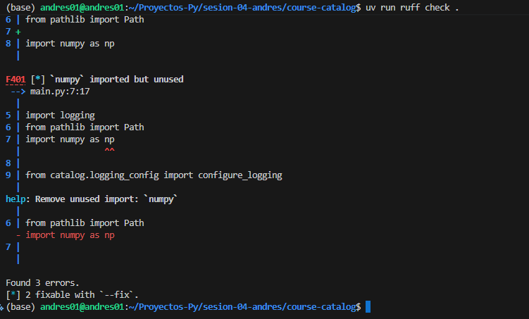

### Corrígelo.
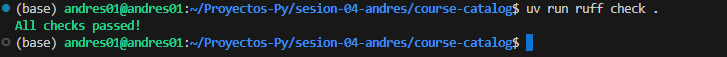

## Ejercicio 7 · Comprobar desde una copia limpia
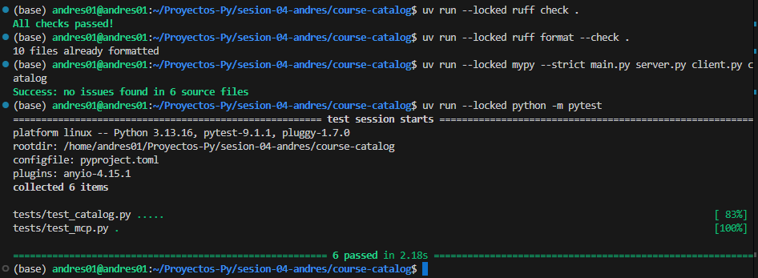

### Ejecuta las comprobaciones de Ruff, mypy y las pruebas existentes con pytest desde una copia limpia.

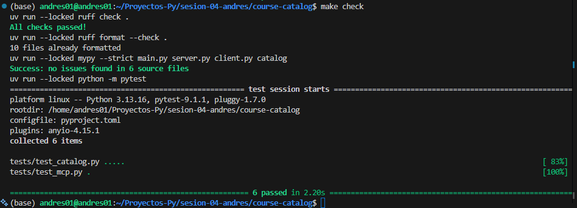

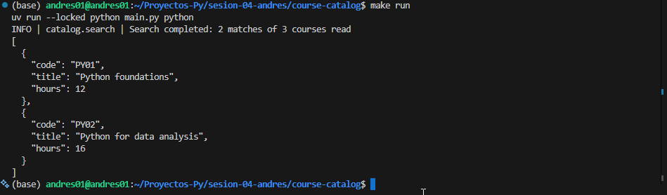

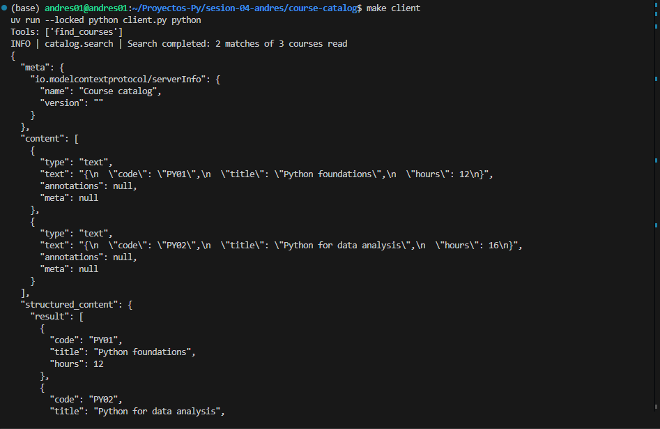

